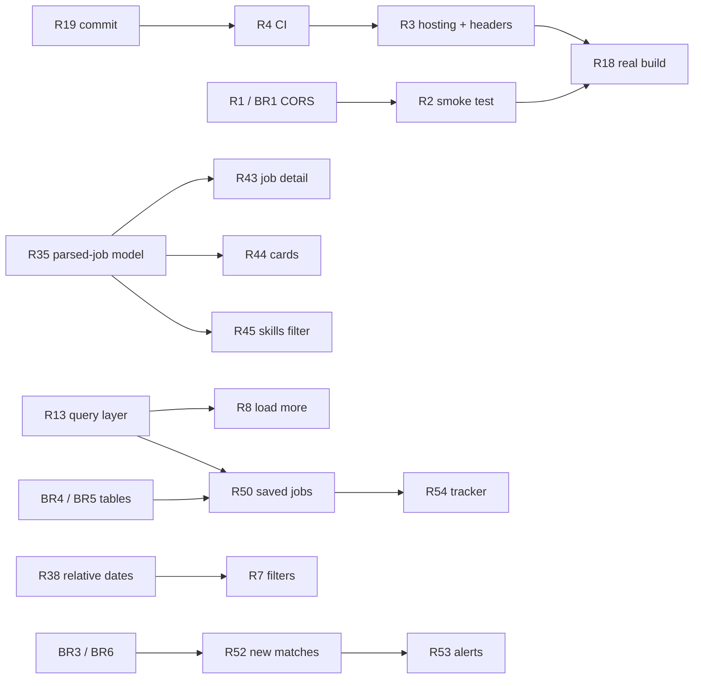

# Roadmap

Forward-looking and prioritized. Statuses: `todo`, `doing`, `blocked`, `done` (done items are
recorded in [DEVELOPMENT_LOG.md](DEVELOPMENT_LOG.md) and removed from here). Each item names *why* it
matters, so priorities can be re-judged later.

Last reviewed: 2026-11-19 - full re-plan from a code, docs and backend review (log entry "Roadmap
re-plan from a full review").

**How to read it**

- Phases are ordered; items inside a phase are in priority order. Phases 1 and 2 can interleave once
  Phase 0 is done.
- IDs are stable and never reused. R1-R18 keep their numbers (the log and ADRs refer to them); new
  items start at R19. The number says when an item was added, not its priority.
- Size: **S** = up to 1 day, **M** = 2-5 days, **L** = 1-3 weeks (one developer). Estimates, not
  commitments.
- **Needs** lists prerequisites: other items, backend change requests (**BRn**, applied in the
  `JobObserver` repo, see [below](#backend-change-requests-jobobserver-repo)) and open decisions
  (**Dn**, see [Decisions needed](#decisions-needed)).

## Product goal

JobObserver aggregates postings from ATS APIs, job aggregators and Telegram into one deduplicated
index with provenance and optional AI (semantic) search. For a job seeker the web client should:

1. **Find** relevant roles fast (search, filters, AI search).
2. **Judge** a posting without leaving the app (structured facts, sources, link to the original).
3. **Track** what they have seen, saved and applied to.
4. **Observe**: be told when new matching postings appear. The backend hard-deletes jobs after
   `MAX_JOB_AGE_DAYS` (default 10, migration `20260509120001`), so catching new postings early is
   the core value, not browsing an archive.

Desktop parity ([FEATURE_PARITY.md](FEATURE_PARITY.md)) is the floor. Today the web covers (1) at
desktop level, (2) minimally, and nothing of (3) or (4); neither does the desktop. Comparable
products (LinkedIn Jobs, Indeed, Welcome to the Jungle / Otta, Wellfound, Remote OK, Hiring Cafe;
trackers such as Teal and Huntr) all offer saved jobs, alerts on saved searches, filter chips,
pagination and a list + detail layout. Those are the main product gaps below.

## Where the app stands (review 2026-11-19)

Solid: a ports/adapters seam with a complete mock, the URL as search state, sanitized rendering,
contract tests that pin the desktop's wire format, 61 green tests, a small dependency set.

Weak:

- **Not production-grade yet.** The code is committed and pushed to `main`, but `main` is not
  protected (no required PRs or checks). No CI, linter, hosting, security headers or error boundary.
- **One confirmed security gap.** The description sanitizer lets through full-screen `style`
  overlays and `<form>`s that post to external URLs (R20).
- **Defects.** AI results always say "just now", sign-in drops deep links, nothing shows that
  results are refreshing, Settings shows a UUID, several failures go unhandled (Phase 1).
- **Unused backend data.** Since migration `20260520120001` every job carries LLM-parsed
  `parsed_json` (summary, responsibilities, requirements, tech stack, years required). The web
  fetches it (`select('*')`) and drops it in `jobFromRow`. `match_jobs_ai` also returns `seniority`,
  `description_snippet` and country codes, which `aiHitFromRow` drops.
- **Architecture limits for what comes next.** The hand-rolled `useAsync` has no pagination,
  mutations or invalidation; errors are untyped; `AuthPort` exposes only a user id; both adapters
  ship in every build (the current real-Supabase `dist/` contains the mock dataset and the demo
  password).

## Phases at a glance

| Phase | Goal | Done when |
| --- | --- | --- |
| 0 | Ship safely | Real Supabase build hosted from CI with security headers; e2e green in 3 browsers; no known security gap |
| 1 | Fix what is broken | Every defect below fixed, each with a regression test |
| 2 | Architecture for growth | Server-state layer, typed errors, parsed-job model, capabilities and code splitting in place |
| 3 | Find and judge (job-board table stakes) | A first-time user narrows, pages through and judges postings on phone and desktop without leaving the app |
| 4 | Track and observe | Saved jobs, hidden jobs, application status, "N new" on saved searches, e-mail alerts |
| 5 | Accounts and trust | Self-service password reset, account page with deletion and export, session-expiry UX |
| 6 | Platform and reach | PWA, i18n, audited accessibility, observability |

Milestones: **M1 "Live and safe"** = Phase 0 + R24-R30. **M2 "Better than the desktop at finding
jobs"** = R13, R34-R38 + Phase 3. **M3 "Observer"** = Phase 4 + R56.

Key dependencies:

## Phase 0 - Ship safely

| # | Item | Why / evidence | Size | Needs | Status |
| --- | --- | --- | --- | --- | --- |
| R19 | **Protect `main`** (require PRs and passing checks). The code itself is already committed and pushed | Direct pushes to `main` can bypass review and the checks R4 adds; CI and preview deploys (R4) build on this | S | owner | todo |
| R20 | **Harden description sanitization** in `HtmlContent`: forbid the `style` attribute and `form` / `input` / `button` / `select` / `textarea`; decide on remote images (D9); extend the hostile fixture and mutation-check the test | Verified with the app's DOMPurify options: `
` (a full-screen overlay on the app's origin) and `<form action="https://evil..."><input type=password>` (credential phishing) both survive. Remote `` lets sources track readers. Scripts, `<style>` and `on*` handlers are already stripped | S | D9 | todo |
| R1 | **Apply the CORS patch to `ai-job-search`** and redeploy ([BACKEND_CONTRACT.md](BACKEND_CONTRACT.md#required-backend-change-cors), [ADR-013](DECISIONS.md#adr-013)) | AI search is the only desktop feature that cannot work from a browser. Source re-checked 2026-11-19: the handler still answers `OPTIONS` with 405 | S | BR1 | blocked (owner action in other repo) |
| R21 | **Lint and format**: ESLint flat config (typescript-eslint, react-hooks, jsx-a11y), Prettier, and import-boundary rules that encode CLAUDE.md rules 1-3 (`no-restricted-imports` per folder, or `eslint-plugin-boundaries`). Fix what it finds, including `app/config.ts` importing the `SupabaseConfig` type from the adapter | The architecture rules are enforced by review only; a violation already slipped in during initial development (log: "Mock backend") | S | - | todo |
| R4 | **CI** (GitHub Actions): `pnpm install --frozen-lockfile`, lint, typecheck, test, build, gzip bundle budget, e2e (R5); a preview deploy per PR | Keeps parity and regressions from slipping | S | R19, R21 | todo |
| R3 | **Hosting** (Netlify / Vercel / Cloudflare Pages / S3 + CloudFront, D5): SPA rewrite, deploy docs, and **security headers**: CSP (`default-src 'self'; connect-src <supabase origin>; img-src 'self' https: data:; form-action 'self'; frame-ancestors 'none'; base-uri 'self'`), HSTS, `Referrer-Policy`, `X-Content-Type-Options`, `Permissions-Policy` | Nobody can reach the app yet. CSP is the second line of defence behind DOMPurify for scraped HTML (`form-action 'self'` alone stops the phishing form) | M | R4, D5 | todo |
| R5 | **Real-browser verification**: Playwright e2e against the mock build in Chromium, Firefox and WebKit plus a phone viewport, run in CI; one manual visual pass and fixes | Built and tested in jsdom only. The planned manual browser pass never happened | M | R4 | todo |
| R22 | **Error boundary**: a top-level boundary with a "Something went wrong - reload" screen; per-route boundaries come with R39 | A render exception blanks the whole app; `main.tsx` has no boundary | S | - | todo |
| R23 | **Production shell**: favicon and app icons, meta description, `theme-color`, `noindex` while the app requires sign-in | `index.html` has only a title; `public/` does not exist | S | - | todo |
| R2 | Run the manual smoke checklist against the real project and record the result in the log | The mock proves the contract we *believe* in, not the live one | S | R1 for the AI step | todo |
| R18 | Replace the any-credentials demo build ([ADR-015](DECISIONS.md#adr-015)) with a real Supabase build (`VITE_BACKEND=supabase`, no `VITE_MOCK_ANY_CREDENTIALS`) before the app is exposed to anyone with real data | The demo build has no real authentication by design | S | R1-R3 | todo |

## Phase 1 - Fix what is broken

Each fix lands with a regression test that fails without it.

| # | Defect | Evidence and fix | Size | Status |
| --- | --- | --- | --- | --- |
| R24 | **AI results show "just now" and "1 source"** whatever the job | `aiHitFromRow` sets `firstSeenAt = now` and `sourceCount = 1` ([mappers.ts](../src/adapters/supabase/mappers.ts)); `JobCard` shows `postedAt ?? firstSeenAt`. Make these fields optional in `SearchHit` and render nothing when unknown. Map the `seniority`, `location_country_codes` and `description_snippet` that `match_jobs_ai` already returns | S | todo |
| R25 | **Deep links are lost at sign-in** | `RequireAuth` redirects to `/login` without the original location, and `LoginPage` / `LoginRoute` always go to `/search` ([App.tsx](../src/App.tsx), [LoginPage.tsx](../src/ui/pages/LoginPage.tsx)). A shared `/jobs/<id>` or `/search?q=...` link (ADR-005's main promise) lands on an empty search. Carry `from` in router state and accept only in-app paths (no open redirect) | S | todo |
| R26 | **No feedback while results refresh** | `useAsync` keeps the previous data while loading, and `SearchPage` shows "Loading..." only when there is none. After a filter click the old list sits unchanged for the whole request. Show a progress bar or dim the list; announce the result count | S | todo |
| R27 | **Settings shows a UUID as "Signed in as"** | `AuthPort.subscribe` yields only an id. Emit `User { id, email }` from both adapters (port change, rule 7) | S | todo |
| R28 | **Unhandled failures** | Deleting a saved search and signing out have no `catch`: a failure is a silent unhandled rejection. Handle them and add one shared toast/notice component (this also fixes the "Saved ..." notice that never clears) | S | todo |
| R29 | **AI failure is a dead end** | Any `ai-job-search` error (today: every call from a browser, because of CORS) shows `Error: ai-job-search failed...` and no results. Fall back to standard results with a banner and keep the detail behind a disclosure. This deviates from the desktop: record it as an ADR-010 addendum (D8) | S | todo |
| R30 | **Search history survives sign-out** | The search cache (`jo:<backend>:search:*`, whose keys contain the queries) is not cleared on sign-out or user change, so on a shared device the next user can read what the last one searched. Clear it on sign-out | S | todo |
| R31 | **Dialog accessibility** | `NamePromptDialog` has no focus trap, does not return focus to the trigger, and Escape works only while focus is inside it. A native `<dialog>` opened with `showModal()` gives all three | S | todo |
| R32 | **Silent SPA navigation** | `document.title` is always "JobObserver" and focus stays put on route change, so screen readers announce nothing and tabs and history entries look identical. Set per-route titles (the job title on detail) and focus the `h1` | S | todo |
| R33 | **Small correctness bugs** | `formatPosted` renders invalid and future dates as "just now"; `shortNumber(999_500)` renders "1000k"; the salary slider announces "120000" (add `aria-valuetext`); `filtersKey` depends on array order, so `remote=a,b` and `remote=b,a` miss each other in the cache | S | todo |

## Phase 2 - Architecture for growth

| # | Item | Why / evidence | Size | Needs | Status |
| --- | --- | --- | --- | --- | --- |
| R13 | **Server-state layer**: replace `useAsync` with TanStack Query in `app/` (`useSearch`, `useJob`, `useSavedSearches`...). Core services stay framework-free; query keys come from a normalized `filtersKey`. Decide how the 30-minute `localStorage` cache fits (stays in `SearchService`, or becomes the query persister) | Unblocks pagination (R8), optimistic mutations and automatic invalidation (saved searches call `reload()` by hand today), retries and de-duplication. Also fixes a latent `useAsync` bug: on a key change it keeps showing the *previous* entity until the new one loads. Supersedes part of ADR-002, so it needs a new ADR | M | D2 | todo |
| R34 | **Typed backend errors**: ports reject with a `BackendError` whose kind is one of network, unauthorized, notFound, rateLimited, unavailable, invalid, unknown, mapped in each adapter. The UI shows per-kind copy and a retry; unauthorized sends the user to sign in and back (R59) | Raw server strings reach users (`Error: ...`). Offline, an expired session and a CORS failure look the same | M | - | todo |
| R35 | **Domain model v2, parsed jobs**: `Job` gains `summary`, `responsibilities`, `requiredQualifications`, `preferredQualifications`, `techStack`, `yearsRequired`, `benefits`, `language`, `parseQuality` from `parsed_json`; `SearchHit` gains optional `seniority`, `countryCodes`, `techStack`, `snippet`. Update both adapters, the mock dataset, the mapper tests and BACKEND_CONTRACT.md | The backend data exists and is already fetched. Unblocks R43-R45 | M | - | todo |
| R36 | **Capabilities on the port**: `Backend.capabilities` (`aiSearch`, `totalCount`, `techFilter`, `savedJobs`, `alerts`...) so the UI hides or explains what a deployment cannot do yet instead of failing | Lets web features ship before their backend migration is deployed (AI before CORS; Phase 4 before BR4-BR7). The mock still implements everything (rule 7). Needs an ADR | S | - | todo |
| R37 | **Code splitting and bundle budget**: `import()` the selected adapter in the factory; lazy-load routes and DOMPurify (detail page only); enforce the budget in CI | Both adapters are imported statically, so every build ships supabase-js *and* the mock dataset (the current real-Supabase `dist/` contains `demo1234`). About 139 kB gzip at the last measurement | S | R4 | todo |
| R38 | **Relative date filters** (D3): a URL token such as `after=7d` and a new `query_json` key (for example `posted_within_days`). Never change the meaning of `posted_after`, which the desktop parses | An absolute `posted_after` in a saved or shared search goes stale. The desktop reads keys by name and ignores unknown ones (`apps/desktop/lib/models/saved_search.dart`), so a new key is safe. Prerequisite for R7's date filter. Needs an ADR | S | D3 | todo |
| R12 | Generate or verify the wire types from the Supabase schema (`supabase gen types`) | Removes hand-maintained column names; `parsed_json` (R35) makes the mapping larger | S | - | todo |
| R11 | Opt-in live smoke test (`pnpm test:live`: credentials from env; 1 search, 1 job, 1 saved-search round trip) | Catches backend drift the mappers can't. The backend changed twice after the desktop inventory without the web noticing | S | R18 | todo |
| R39 | **Dependency upgrades**, one major per PR behind green CI and e2e: React 19, React Router 7 (data router: lazy routes and per-route `errorElement`), current Vite / Vitest / TypeScript; Renovate or Dependabot | Stay on supported majors; the data router simplifies R22 and R37 | M | R4, R5 | todo |
| R40 | **Test gaps**: coverage report with thresholds for `core/` and `adapters/`; component tests for `FiltersPanel` and `JobCard`; axe checks in the e2e run | UI coverage is a single integration file; accessibility is unverified | S | R5 | todo |

## Phase 3 - Find and judge (job-board table stakes)

Mostly web-only work; the Needs column marks where the backend helps.

| # | Item | Why / evidence | Size | Needs | Status |
| --- | --- | --- | --- | --- | --- |
| R7 | **Expose the hidden filters**: posted within (24 h / 3 d / 7 d; options capped by backend retention, currently 10 days), countries (searchable multi-select), remote scope | The backend and the web model already carry them; only the UI is missing | S-M | R38 | todo |
| R41 | **Active-filter chips and a mobile filter drawer**: chips above the results ("Remote x", ">= $120k x"), "Clear all", a count badge; below 760 px the filters move behind a "Filters (3)" button into a drawer | On phones the filters panel stacks above the results and pushes them below the fold. There is no way to reset filters | M | - | todo |
| R8 | **Pagination**: "Load more" with `result_offset` (or infinite scroll with a sentinel), a "50+ results" label, scroll position restored on Back | Desktop and web show only the first 50. `search_jobs` has no total count (BR2 for "N results") | M | R13, BR2 (optional) | todo |
| R42 | **List + detail layout on wide screens**: results on the left, the selected job on the right (selection in the URL; phones keep the separate page); keyboard navigation (`j` / `k`, `Enter`, `Esc`, `/` focuses search) | The standard job-board layout. Today scanning postings costs a page round trip each | M-L | R43 | todo |
| R43 | **Structured job detail**: a fact row (salary, remote type and scope, seniority, employment, countries, posted / first seen / last seen), parsed sections (summary, responsibilities, required and preferred qualifications, benefits) with the original description collapsible, tech-stack chips, copy link / Web Share, a sticky "Apply" button on phones, and "This posting is no longer available" instead of "Not found" | The page shows title, company, location and raw HTML only, although the model already holds salary, seniority and more. RLS hides inactive jobs and cleanup deletes them after about 10 days, so "Not found" is the common case for old links | M | R35 | todo |
| R44 | **Richer result cards**: seniority, employment, top tech-stack chips; snippet and match strength for AI results; query-term highlighting | Cards show title, company, location, remote type, salary and age only | S-M | R35, BR2 for standard hits | todo |
| R45 | **Skills filter** with autocomplete from the normalized tech vocabulary (`tech_stack`; a GIN index on `parsed_json` exists) | The most-used filter on tech job boards, and the backend was designed for it ("filter chips become trivial", `JobObserver/docs/parsed-jobs-design.md`) | M | R35, BR3 | todo |
| R46 | **Seen and new markers**: dim visited cards; a "New" badge on postings first seen since the user's last visit (local, per device, first) | With roughly 10-day retention users come back often and need to see what changed | S | D4 | todo |
| R47 | **Empty and error states**: skeleton loaders; on no results, suggest removing the narrowest filter or trying AI search; retry buttons | Today the states are "Loading...", "No results" and "Error: <raw message>" | S | R34 | todo |
| R6 | **Saved searches, complete**: rename (the service already supports it), "update with current filters", a duplicate-name guard, delete with undo, a summary that covers every filter, and AI mode kept (`ai` / `planner` keys in `query_json`) | `summarizeSavedSearch` shows only query, remote type and salary, so two different searches can look identical. "Run" always resets to standard search | S-M | - | todo |
| R10 | Salary currency awareness: label the min-salary filter with the right currency or let the user choose one | The filter compares raw numbers across currencies under a `$` label, which misleads for EUR/GBP postings. True conversion needs the backend | S (label), M (conversion) | backend for conversion | todo |
| R48 | **Recent searches** in a dropdown on the search box (local) | Cheap, and users repeat the same few searches daily | S | - | todo |
| R49 | **Theme and density settings**: system / light / dark; comfortable / compact list | Dark mode follows the OS only | S | - | todo |

## Phase 4 - Track and observe

Needs backend work (BR4-BR7). With R36 in place each item can ship behind its capability flag.

| # | Item | Why / evidence | Size | Needs | Status |
| --- | --- | --- | --- | --- | --- |
| R50 | **Saved jobs**: a star on card and detail, a "Saved jobs" page, a new `SavedJobsPort` in both adapters | The most basic job-board feature after search. Jobs are hard-deleted after about 10 days, so the row must keep a snapshot (title, company, URL, salary) or the backend must exempt saved jobs from cleanup | M | R13, R36, BR4, D4 | todo |
| R51 | **Hide job / hide company** ("Not interested"), managed in Settings | Repeated irrelevant postings are the classic aggregator complaint. Client-side filtering shortens pages; server-side exclusion avoids that | M | BR5 (BR3 for server-side) | todo |
| R52 | **"N new" on saved searches** since each was last opened | The observe loop inside the app. Needs a first-seen-after filter (`posted_at` comes from the source and can be old for a freshly ingested job) and `last_viewed_at` per saved search | M | BR3, BR6 | todo |
| R53 | **Alerts**: a daily or weekly e-mail digest per saved search, preferences and one-click unsubscribe; web push later (R15) | The point of an observer: users should not have to open the app to learn about a match that may be deleted within days | L | R52, BR7 | todo |
| R54 | **Application tracker**: a status per saved job (saved, applied, interviewing, offer, rejected, withdrawn), applied date, notes, follow-up date; list and board views; CSV export | Teal/Huntr-style tracking keeps users in the product after they find a posting | L | R50, BR5 | todo |
| R55 | **Personal defaults**: preferred countries, currency and default filters applied to new searches | Saves re-entering the same filters on every visit | S-M | - | todo |

## Phase 5 - Accounts and trust

| # | Item | Why / evidence | Size | Needs | Status |
| --- | --- | --- | --- | --- | --- |
| R56 | **Password reset**: "Forgot password?", reset e-mail, then a set-new-password page on the `PASSWORD_RECOVERY` event; the port gains `requestPasswordReset` and `updatePassword` | Today a forgotten password needs the owner. The desktop has no reset either | S-M | BR9 | todo |
| R57 | **More sign-in options** (D7): magic link and/or OAuth (Google, GitHub, LinkedIn) | Expected on consumer web apps; fewer passwords to forget | M | BR9, D7 | todo |
| R58 | **Account page**: e-mail, change password or e-mail, export my data, delete account | Deleting a user needs the service role, so it must be a server-side function, never the browser | M | R27, BR8 | todo |
| R59 | **Session-expired UX**: "Your session expired - sign in again", then back to the same URL | Today an expired refresh token silently drops the user on the login page | S | R25, R34 | todo |
| R9 | Public browsing without sign-in ([ADR-008](DECISIONS.md#adr-008)); AI search, saving and tracking stay gated | RLS already allows anon reads; shared links would work for recipients without an account | M | D1 | todo (product decision) |
| R60 | **Privacy policy and terms** pages, linked from sign-in | Needed once real users sign up; states what is kept in `localStorage` and in Supabase | S | - | todo |

## Phase 6 - Platform and reach

| # | Item | Why / evidence | Size | Needs | Status |
| --- | --- | --- | --- | --- | --- |
| R15 | PWA / installable shell, offline cached results; enables web push for R53 | Desktop-like "app" feel | M | R3 | todo |
| R14 | i18n and localized dates and numbers (`Intl.RelativeTimeFormat`, `Intl.NumberFormat` for salaries) | Strings and dates are English-only | M | - | todo |
| R16 | Accessibility audit (axe in CI via R40, a keyboard-only pass, a screen-reader pass) | Built with labels and roles but never audited | M | R40 | todo |
| R61 | **Observability** (D6): client error reporting with PII scrubbing, Web Vitals, privacy-friendly usage analytics | Without it, production failures are invisible and priorities are guesses | S-M | R3, D6 | todo |
| R62 | List virtualization once "Load more" makes lists long | Keeps scrolling smooth past a few hundred cards | S | R8 | todo |
| R17 | Move shared domain code (filters, URL codec) to a package if a third client appears | Avoid premature extraction | M | - | todo |

## Backend change requests (JobObserver repo)

Owner actions in the other repo, following the ADR-013 precedent: specified here, applied there.
Keep every change **additive** (new arguments with defaults, new columns, new tables) so the desktop
keeps working. When `search_jobs` changes signature, drop the old overload in the same migration
(`PGRST203`) and update `searchRpcParams` and its test in the matching web change.

| # | Change | Unblocks |
| --- | --- | --- |
| BR1 | CORS on `ai-job-search` (patch in [BACKEND_CONTRACT.md](BACKEND_CONTRACT.md#required-backend-change-cors)) | R1, AI search in browsers |
| BR2 | `search_jobs` also returns `seniority`, `location_country_codes`, `tech_stack`, and a total count or `has_more` | R8 label, R44 |
| BR3 | `search_jobs` filters for `tech_stack`, `first_seen_after`, and optionally `exclude_job_ids` / `exclude_companies` (and the same in `ai-job-search`) | R45, R51, R52 |
| BR4 | `saved_jobs` table + RLS, with a snapshot or an exemption from cleanup | R50, R54 |
| BR5 | Per-user job state: hidden jobs and companies, application status, notes + RLS | R51, R54 |
| BR6 | `saved_searches.last_viewed_at` and `alert_frequency` columns | R52, R53 |
| BR7 | Alert sender: a scheduled function, an e-mail provider, unsubscribe tokens | R53 |
| BR8 | Account deletion and data export function (service role, server-side only) | R58 |
| BR9 | Auth: site URL and redirect URLs for the web origin; OAuth providers if D7 says so | R56, R57 |
| BR10 | Facet counts for the current query (optional) | Counts on the R41 chips |

## Decisions needed

Each becomes an ADR in [DECISIONS.md](DECISIONS.md) when taken.

| # | Question | Recommendation | Blocks |
| --- | --- | --- | --- |
| D1 | Allow browsing without sign-in? | Yes for search and job detail; keep AI search, saving and tracking gated | R9 |
| D2 | Adopt a server-state library or keep growing `useAsync`? | TanStack Query, used in `app/` only; `core/` stays framework-free | R13 |
| D3 | How to encode relative dates in the URL and in `query_json`? | `after=7d` in the URL, a new `posted_within_days` key; `posted_after` unchanged | R38, R7 |
| D4 | Where does personal data live (saved jobs, statuses, seen markers)? | Server for saved jobs and statuses (cross-device, and the desktop can adopt them); local for seen/new markers | R46, R50, R54 |
| D5 | Which hosting provider? | Any static host with rewrites, custom headers and preview deploys; choose on cost | R3 |
| D6 | Which error-reporting / analytics vendor, and what privacy stance? | Error reporting with PII scrubbing; cookieless analytics or none | R61 |
| D7 | Which sign-in methods besides password? | Magic link first (no provider setup); OAuth when users ask for it | R57 |
| D8 | Should an AI failure fall back to standard results (a deviation from the desktop)? | Yes, with a visible banner | R29 |
| D9 | What to do with remote images in scraped descriptions? | Click-to-load per job (privacy); at minimum `referrerpolicy="no-referrer"` | R20 |

## Desktop follow-ups

Parity is one-way (the web must cover the desktop), but the two clients share data. When these items
ship, the desktop shows less than the web; record them as web-only rows in FEATURE_PARITY.md:

- Saved jobs, hidden jobs/companies and application status (R50, R51, R54) stay invisible on the
  desktop until it adopts BR4/BR5.
- A saved search with a relative date or AI mode (R38, R6) runs on the desktop **without** them,
  because the desktop ignores unknown `query_json` keys.
- Renaming a saved search (R6) shows on the desktop automatically (shared column).

## Explicitly out of scope (for now)

- Server-side rendering / SEO ([ADR-002](DECISIONS.md#adr-002)). Revisit only together with R9, if
  public job pages should be indexed or show link previews (Open Graph needs server-rendered HTML).
- Any write path to jobs (ingest stays in the `JobObserver` connectors).
- Admin/diagnostic views of connector runs (readable via RLS, not needed by users).
- Employer-side features (posting jobs, applicant management), auto-apply bots, CV builders.
- Native mobile apps: the PWA (R15) covers phones.
